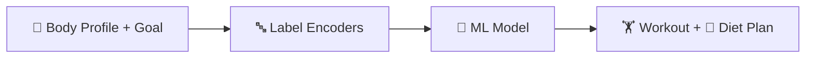

<div align="center">


<b><i>ML-powered personalised fitness & diet recommendations</i></b>


       

   
</div>

---

## 💪 About the Project

Inspired by *“A Systematic Machine Learning Approach in Fitness Platforms”*, this app analyses a user's profile — sex, age, height, weight, BMI, hypertension, diabetes, level and fitness goal — and recommends **exercises, equipment, diet and fitness type** using a trained ML model.

## ✨ Key Features

- 🔐 Login and personal **dashboard**
- 🏋️ Recommends **exercises, equipment & fitness type**
- 🥗 Suggests a matching **diet plan**
- 🗄️ Saves prediction history in **SQLite** (`predictions.db`)
- 📓 Full training notebook `Fitness Tracker.ipynb`

## 🧠 How It Works



## 🛠️ Tech Stack

| Layer | Technology |
|---|---|
| Language | Python 3 |
| Data & ML | Pandas · NumPy · scikit-learn |
| Notebook | Jupyter |
| Web App | Flask + Jinja2 templates |
| Frontend | HTML5 · CSS3 |
| Database | SQLite |

## 📂 Project Structure

```text
├── abstract/ · basepaper/
└── code/Fitness Tracker/
    ├── app.py
    ├── Fitness Tracker.ipynb
    ├── fitness-recommendation-dataset.xlsx
    ├── model.pkl + le_*.pkl encoders
    ├── predictions.db
    └── templates/ (home, login, dashboard, prediction, ...)
```

## 🚀 Getting Started

```bash
git clone https://github.com/PreciousBharath/FITNESS-TRACKER.git
cd "FITNESS-TRACKER/code/Fitness Tracker"
pip install flask pandas numpy scikit-learn openpyxl
python app.py
```

## 🤝 Contributing

Contributions, issues and feature requests are welcome! Feel free to ⭐ star the repo and open a pull request.

## 👨‍💻 Author

<div align="center">

**Bharath** — Software Developer · Project Engineer · Technical Trainer

<a href="https://github.com/PreciousBharath"></a>
<a href="https://linkedin.com/in/connectbharath"></a>

### 🍔 EAT · 💻 CODE · 😴 SLEEP · 🔁 REPEAT

⭐ **If you found this project useful, give it a star!** ⭐


</div>
